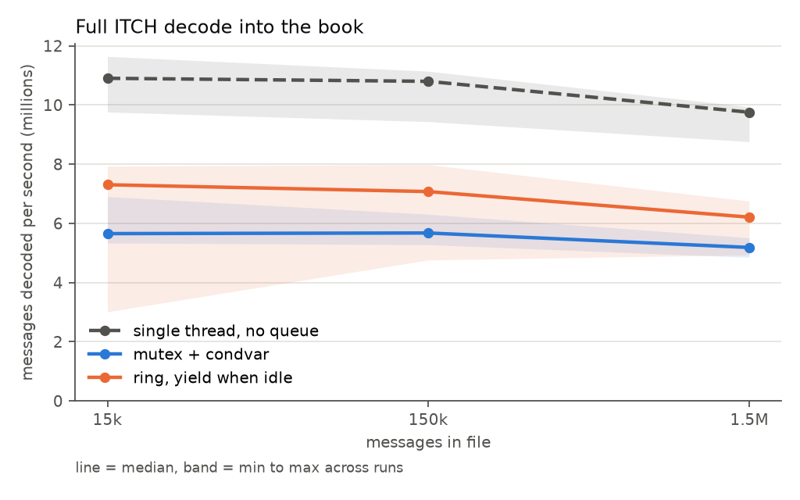
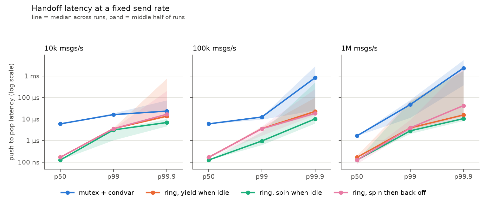
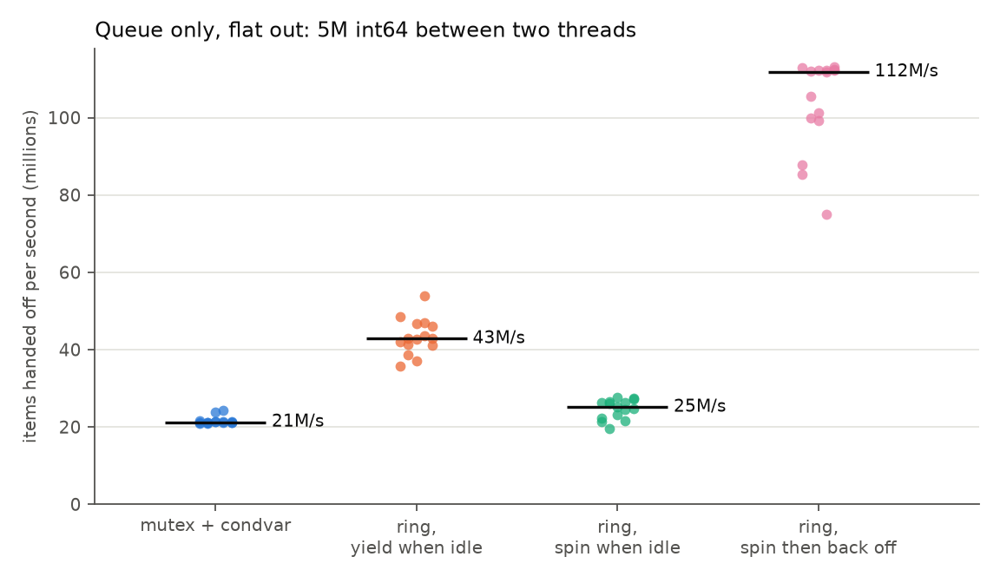
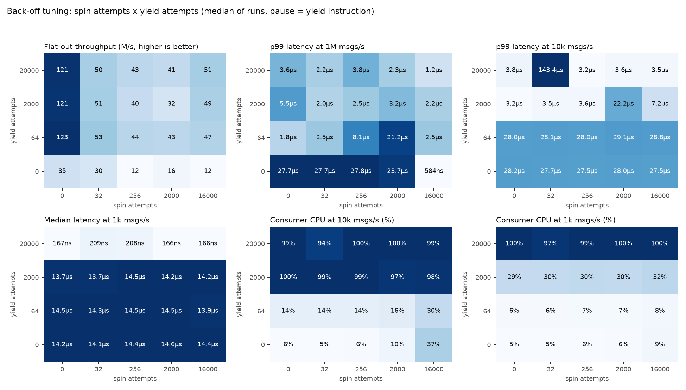

# queue benchmarks

Comparing ways to hand messages from the parser thread to the handler thread:

- **mutex + condvar** — the original, `std::queue` behind a mutex. Kept in `Core/Source/Baseline/MutexDecoder.cpp`.
- **ring, yield when idle** — the lock-free SPSC ring in `Core/Source/Core/CircularBuffer.h`, calling `std::this_thread::yield()` when full/empty. This is what `Decoder` uses.
- **ring, spin when idle** — same ring, CPU pause instruction instead of `yield()`.
- **single thread** — no queue at all (`Core/Source/Baseline/SingleThreadDecoder.cpp`). Only in the decode test.

File mapping, framing, `itch::decode_message`, `itch::handle_message` and the book are shared, so the handoff is the only difference.

M2 Max, macOS 14.6.1, Apple clang 16, `-O2`. Order of variants rotates every run. Benchmark-owned threads run at
`QOS_CLASS_USER_INTERACTIVE` (new threads get the default class otherwise and can land on efficiency cores).

```
make queue_report
```

regenerates fixtures, reruns everything and redraws the plots. Takes about 3 minutes.

## Full decode

| messages | single thread | mutex | ring, yield |
|---|---|---|---|
| 15k | 11.02 M/s | 5.70 | 7.60 |
| 150k | 10.89 M/s | 5.75 | 7.54 |
| 1.5M | 10.06 M/s | 5.36 | 6.90 |



The ring is ~30% ahead of the mutex end to end. It wasn't always: the first version of this table had all three
around 4 M/s and the ring within noise of the mutex, because every message was paying for things that had nothing to
do with the queue. Three changes moved it (150k / 1.5M messages, alternating runs against the previous binary):

| change | single | mutex | ring |
|---|---|---|---|
| mmap the file, decode from spans (was: `ifstream` + a `std::vector` per frame) | +59% / +35% | +42% / +14% | +49% / +15% |
| `Order` stored by value in the level list (was: `unique_ptr<Order>` in the list) | +10% / +62% | -1% / +22% | +10% / +40% |
| list and order-index nodes from a per-book `pmr` pool | +16% / +18% | +7% / +11% | +2% / +12% |
| all three | 2.0x / 2.6x | +53% / +55% | +66% / +82% |

Once the per-message cost dropped from ~250 ns to ~140 ns (ring) the handoff became a big enough share of it to see.

One thread is still the fastest way to replay a file, by a lot. The two-thread versions allocate each message on the
parser thread and free it on the handler thread, and add a handoff, and parse + apply are both short. The pipeline is
for a live feed where the network read can't wait on the book; there the number that matters is latency, below.

All three decoders produce the same book on the 1.5M file (same resting orders and depth per level on all 8 locates).

## Where the time goes

`make profile_text` — macOS `sample` on the release ITCH ring decoder for 10 s, 1 ms interval, the 1.5M message file
replayed in a loop. Share of on-CPU samples across the worker threads plus teardown (the main thread's time blocked in
`join` is left out):

| | share | what it is |
|---|---|---|
| `malloc` / `free` | ~38% | the `unique_ptr<Message>` per message: allocated on the parser thread, freed on the handler thread |
| `__dynamic_cast` | ~12% | the cast to the concrete message type in `itch::handle_message` |
| decoding bytes | ~11% | `decode_message`, `decode_header`, `read_u64`/`read_u32`. These are in another .cpp so they aren't inlined |
| destroying the book | ~10% | `~Book` at the end of each run, one pool deallocate per list node and hash node for 1M orders |
| `sched_yield` | ~9% | a thread spinning in `yield()` while the other one catches up |
| pool allocate | ~4% | taking list and index nodes from the pool |
| `std::map` level lookup | ~4% | `SecurityBook::level_for` |
| hash table rehash | ~3% | the order index growing; nothing is reserved up front |
| everything else | ~9% | the book operations themselves, `book_for`, order construction |

So half the time is still the heap-allocated polymorphic message (`malloc`/`free` + `dynamic_cast`). That's the next
thing to fix, and it's the same fix the Databento path already has. The `std::map` I expected to be the big one is 4%.

Teardown showing up at 10% also explains why `make perf` (which times whole runs including destroying the book)
reports ~5.2 M/s where the decode table above (which stops the clock before teardown) reports ~6.9 M/s for the same
decoder.

`make profile` records the same workload in Instruments if you want the GUI.

## Handoff latency

Producer sends at a fixed rate, stamps each item with its scheduled send time, consumer records `now - stamp`.
2 seconds per run, 7 runs. Median across runs. "back-off" is the default `BalancedBackoff` (256 `isb` spins, 2000
yields, then 20 µs sleeps):

| rate | variant | p50 | p99 | p99.9 |
|---|---|---|---|---|
| 10k/s | mutex | 5.96 µs | 16.0 µs | 23.3 µs |
| | ring, yield | 167 ns | 3.6 µs | 13.5 µs |
| | ring, spin | 125 ns | 3.1 µs | 6.9 µs |
| | ring, back-off | 167 ns | 3.5 µs | 16.5 µs |
| 100k/s | mutex | 5.96 µs | 12.4 µs | 824 µs |
| | ring, yield | 167 ns | 3.6 µs | 22.5 µs |
| | ring, spin | 125 ns | 1.0 µs | 10.1 µs |
| | ring, back-off | 167 ns | 3.5 µs | 18.4 µs |
| 1M/s | mutex | 1.67 µs | 46.6 µs | 2.3 ms |
| | ring, yield | 167 ns | 3.9 µs | 15.4 µs |
| | ring, spin | 125 ns | 2.8 µs | 10.5 µs |
| | ring, back-off | 125 ns | 3.9 µs | 42.0 µs |



The ring's median is 10–35x below the mutex at every rate: its consumer is already running, the mutex pays a ~6 µs
wakeup. Every ring variant keeps its consumer at ~99% of a core while it waits; the mutex uses 0.3–2%.

p99.9 is mostly the OS on this laptop and moves a lot between sessions (the mutex's went from 22 µs to 2.3 ms at 1M/s
between two runs of the same code). Only claim big gaps in that column.

Clock resolution here is ~42 ns (mach ticks), so 83, 125 and 167 are 2, 3 and 4 ticks.

## Queue only, flat out

5M `int64_t`, producer pushes as fast as it can, 15 runs:

| variant | median |
|---|---|
| mutex | 21.3 M/s |
| ring, yield | 42.8 M/s |
| ring, spin | 25.1 M/s |
| ring, back-off | 111.8 M/s |



## Idle strategy

What a side does when the ring is empty (consumer) or full (producer). It's a template parameter on
`MessagePipeline` (`Core/Source/Core/IdleStrategy.h`):

- **yield** — `std::this_thread::yield()`, a system call that gives the core to the OS scheduler
- **spin** — a pause instruction in a tight loop, never gives the core up
- **back-off** — pause N times, then yield M times, then sleep 20 µs at a time; reset after every successful push/pop

The spin variant is the worst flat out (25 M/s, barely above the mutex): the waiting side keeps re-reading the other
side's counter, so the cache line bounces between cores. Back-off with the right settings is the best (112 M/s) and
matches spin's latency at high rates.

### Tuning the back-off

`make backoff_sweep` (~5 min): spin attempts {0, 32, 256, 2000, 16000} x yield attempts {0, 64, 2000, 20000}, the
`isb` pause for three of them, plus pure yield and pure spin; 3 runs each; five scenarios (flat out, paced at 1M / 100k
/ 10k / 1k msgs/s). Also records the consumer thread's CPU time. Results in `backoff_sweep.csv` and
`backoff_sweep_summary.csv`:



- **Spinning on the `yield` instruction kills throughput.** Any back-off that spins ≥32 times with it gets 30–54 M/s.
  The ARM `yield` instruction is a no-op on this core (below), so that's a hard spin hammering a shared cache line.
- **Either don't spin, or spin with a real delay.** 0 spins then yield: ~121 M/s. 32–256 spins with `isb` (~9 ns
  each): 111–122 M/s.
- **Spins still buy latency at high rates.** At 1M msgs/s a message arrives every 1 µs; 256 `isb` spins (~2–3 µs)
  catch it while still spinning: 83 ns median. With 0 spins it's already yielding: 167 ns.
- **Yield attempts decide whether it ever sleeps.** 2000 yields last about a third of a millisecond. With 20000 it
  never sleeps at 1k msgs/s (median 167–209 ns, 99% CPU); with 2000 or fewer it does (median 14 µs, 6–30% CPU).
- **Only sleeping saves CPU.** Anything that doesn't reach the sleep stage at a given rate sits at ~99% of a core,
  plain `yield()` included — it returns immediately when nothing else wants the core.

Profiles in `IdleStrategy.h`, all measured in the sweep:

| profile | settings | flat out | p50 / p99 at 1M/s | quiet feed |
|---|---|---|---|---|
| `BalancedBackoff` (default) | 256 `isb`, 2000 yields | 111 M/s | 83 ns / 1.9 µs | sleeps after ~0.3 ms: 14 µs, 30% CPU at 1k/s |
| `LowLatencyBackoff` | 16000 `yield`, 20000 yields | 51 M/s | 125 ns / 1.2 µs | never sleeps at 1k/s: 166 ns, 100% CPU |
| `LowCpuBackoff` | 0, 64 yields | 123 M/s | 166 ns / 1.8 µs | sleeps almost at once: 28 µs p99 at ≤100k/s, 6–14% CPU |

On the real ESZ6 replay the profile makes no difference (old default 14.28 M/s, new 14.31 M/s): the consumer is
always busy with book work, so it almost never waits.

Where back-off loses: on a very quiet feed (1k msgs/s) the mutex has a 7.5 µs median at 0.3% CPU; balanced back-off
has 14 µs at 30%. Its last stage naps for 20 µs and polls, where the condition variable actually blocks until it's
notified. The fix is to block in the last stage too (`std::atomic::wait`, producer notifies only when the consumer
says it's asleep). Not built yet.

### The pause instruction

`__builtin_arm_yield()` is the ARM `yield` hint, meant for cores that share a pipeline between two hardware threads.
Apple's cores don't, and it measures ~0.3 ns here — same as an empty loop. It doesn't touch the cache and doesn't
delay anything. `isb` (`__builtin_arm_isb(15)`) costs ~9.3 ns. Measured with a 200M-iteration loop of each. Inside
the back-off the real delay is what matters: same spin count, `yield` 39–51 M/s, `isb` 111–122 M/s.

### False sharing in my own pipeline (found and fixed)

`BackoffWhenIdle` has state (a counter), and `reset()` wrote it after every push and every pop. The producer's and
the consumer's idle objects were adjacent members, bytes 388 and 392 of `MessagePipeline` — same cache line — so that
line bounced between cores on every message. The benchmark's `RingQueue` had the same layout. Fixed by putting each
side's idle state on its own 128-byte line and only writing the counter when it isn't already zero.

Earlier back-off numbers (and an earlier version of this README) came from the contaminated build. The extra traffic
changed timing enough to make some configurations look much better than they were, so the sweep was rerun. On the
real replay the fix itself measured neutral (14.05 vs 14.27 M/s, overlapping).

### Batching the consumer

`CircularBuffer::pop_batch` reads `tail_` once, consumes everything available up to a limit, then stores `head_` once.
`MessagePipeline` takes a `MaxBatch` template parameter (default 1). `queue_bench batching`, back-off ring, three
separate sessions:

| | session 1 | session 2 | session 3 |
|---|---|---|---|
| no batching | 42.2 M/s | 38.7 | 39.2 |
| batch 16 | 57.2 M/s | 57.1 | 55.7 |
| batch 256 | 42.2 M/s | 52.0 | 44.6 |

(These used the old 2000/2000 `yield` back-off.) Batch 16 is consistently ~40% faster flat out; 256 is in between and
noisy. Latency at p50 is unchanged. On the full ITCH ring decoder, batch 64 took it from 6.62 to 7.55 M/s.

### More than one consumer

A book can't have two threads applying messages to it, so the only correct multi-consumer design is **sharding**:
the parser sends each message to one of K rings by instrument, and each consumer owns its own books
(`ShardedDecoder`, books merged at the end; `ShardedDecoder.MatchesSingleThreadOnEveryShardCount` checks it builds
the same book). For comparison, a general multi-consumer queue (Vyukov's bounded MPMC queue: a sequence number per
slot, compare-and-swap on the shared positions) where any consumer takes any item — fine for integers, wrong for a book.

Full ITCH decode, 1.5M messages across 8 symbols (`queue_bench shards`, 9 runs):

| | median |
|---|---|
| single thread | 10.29 M/s |
| ring, 1 consumer | 6.62 |
| sharded, 1 / 2 / 4 / 8 consumers | 6.83 / 5.92 / 3.48 / 3.05 |

Queue only, 1 producer to N consumers, 10M integers (`queue_bench fanout`, 5 runs):

| consumers | sharded SPSC rings | MPMC queue |
|---|---|---|
| 1 | 22 M/s | 226 M/s |
| 2 | 21 | 20 |
| 4 | 11 | 8 |

- **More consumers made it slower, in both tests.** With one parser feeding them, the parser is the limit, and each
  extra consumer adds handoff cost without removing any of the parser's work. On the ITCH path every message is also
  allocated on the parser thread and freed on a consumer, so adding consumers spreads those cross-thread frees and
  adds contention. Sharding would need messages by value, or several parsers, before it could pay off.
- **The MPMC queue with one consumer was 4x to 10x faster than my old ring** (two sessions: 198 vs 47, 226 vs 22).
  Its producer and consumer never read each other's position counter: each slot carries its own sequence number, in
  the same cache line as the data. My ring read the other side's counter on every push and pop. That led to the next
  section.
- With 2 or more consumers the MPMC queue collapses: they fight over the shared position with compare-and-swap.

### Making the ring faster

Two fixes for the cross-core read, raced against the old ring and the MPMC queue behind the same back-off and the same
test loop (`queue_bench variants`, `variants.csv`):

- **cached counters**: each side keeps a private copy of the other side's counter and only reloads it when the copy
  says full or empty. Two extra fields, slots unchanged. Now in `CircularBuffer`.
- **per-slot sequence**: each slot carries a sequence number next to the data, so neither side reads the other's
  counter at all (`SequencedBuffer`, kept for comparison).

Bare queue, 10M integers, flat out, median of 5 alternating runs:

| | session 1 | session 2 |
|---|---|---|
| old ring | 100 M/s | 30 |
| cached counters | 341 | 111 |
| per-slot sequence | 347 | 388 |
| MPMC, 1 consumer | 127 | 135 |

The ranking held across sessions; the absolute numbers moved 3x, so the decision came from the real paths
(alternating runs of three builds, 15 ITCH and 12 replay runs each):

| M msgs/s | old ring | cached counters | per-slot sequence | single thread |
|---|---|---|---|---|
| ITCH decode, 1.5M messages | 7.01 | 7.54 | 7.41 | 10.27 |
| CME replay, ESZ6 hour | 14.86 | 16.44 | 16.21 | 9.64 |

Cached counters won both, 7.5% and 11%, quartiles clear of the old ring. Book identical at every event, 17/17 tests,
TSan clean. An earlier prototype of cached counters showed no gain, but it ran with the false sharing above still in.

A ring per shard with the new rings (`queue_bench fanout`, 3 runs, M/s):

| consumers | old ring | cached counters | per-slot sequence | MPMC |
|---|---|---|---|---|
| 1 | 29 | 412 | 420 | 225 |
| 2 | 20 | 26 | 42 | 21 |
| 4 | 11 | 10 | 16 | 8 |

The drop at 2 is the routing: the producer alternates rings item by item, so each consumer pulls the slot's cache line
back after every single write. A one-off run routing in blocks of 64 items gave 172 / 135 M/s for 2 / 4 per-slot
sequence shards and 142 / 89 for cached counters. One producer still caps the total.

## Real data

One hour of CME ESZ6 MBO from Databento (163,149 records), replayed single-threaded with `make replay`, zstd
decompression included:

| | median |
|---|---|
| six message subclasses on the heap, bytes copied into a vector | 4.43 M/s |
| one message class by value | 5.72 M/s |
| decoded from a span, no copy | 6.42 M/s |
| `Order` by value in the list | 7.70 M/s |
| pooled list and index nodes | 9.96 M/s |

Each step measured against the one before in alternating runs. The book printed after every one of the 134,206
completed events is identical at every step.

### Single thread vs ring pipeline on the real data

`make replay_compare` — same file, same decoder and book, 25 alternating runs each, results in
`replay_threading.csv`:

| | median | middle half of runs |
|---|---|---|
| single thread | 9.2–9.5 M/s | 9.0–9.6 |
| ring pipeline (`MessagePipeline<MboMessage, 65536>`) | 11.0–12.3 M/s | 9.8–13.3 |

Two sessions, ring / single = 1.20x and 1.28x. The ring version is noisier.

This is the opposite of the ITCH result above, where one thread beats the pipeline, and the difference is what goes
through the ring. ITCH pushes a `unique_ptr<Message>`: allocated on the parser thread, freed on the handler thread.
Databento pushes an `MboMessage` by value, about 70 bytes, no allocation at all. The producer side also has real work
to overlap with the book (zstd decompression and the SDK's record decoding).

The book printed after every completed event is identical in both modes, and TSan is clean on the ring replay.
Caveat: it's one quiet hour, 163k records, about 15 ms of work, so thread start-up is a visible part of each run.

### Sharding on real multi-instrument data

Six CME futures, one hour (ESZ6, NQZ6, CLX6, GCZ6, ZNZ6, 6EZ6; 1,054,337 records). `databento_replay ... shardedN`:
one ring and one book thread per shard, routed by `instrument_id % N`, books merged at the end. Every mode builds the
same books as the single thread. `parse` decompresses and parses but never touches the book, which is the producer
alone. Median of 11 alternating runs, M2 Max:

| M msgs/s | zstd file | decompressed |
|---|---|---|
| parse only | 16.0 | 37.8 |
| single thread | 7.0 | 9.4 |
| ring | 12.2 | 10.5 |
| sharded 2 | 10.9 | 19.3 |
| sharded 3 | 10.2 | 16.7 |
| sharded 4 | 9.6 | 15.9 |

Sharding pays only when the book thread is the bottleneck and the producer has room. Decompressed (what a live feed
looks like), 2 shards are 1.85x the ring. On the zstd file decompression keeps the producer busy, and fanning out into
several rings makes it slower. Past 2 shards, `id % N` routing is lopsided (one of 6 shards got nothing) and each ring
costs the producer a cache-line handoff per message.

The parser used to drop records with action None. 95,928 of them carried the end-of-event flag, so those events were
never seen as finished. They are kept now, and the record count matches Databento's.

## Fixtures

ITCH: `gen_big_mix.py --locates 8 --mutate-every 4`, adds over 8 symbols with an execute + cancel every 4th add.
Synthetic. Still need a real NASDAQ sample.

## Next

- messages by value in the ITCH ring (a `variant`) instead of `unique_ptr<Message>` — the last per-message allocation on that path, and the one that crosses threads. The Databento pipeline already does this and it's the one case where two threads beat one
- more than one parser, so sharding has something to scale
- a blocking last stage in the back-off
- LTO so the byte readers inline into the decoders (~11% in decode today)
- `reserve` the order index (~3% in rehash), and look at teardown
- flat price levels instead of `std::map` — only ~4% in the profile, so low priority
- real NASDAQ data
