# Linux benchmarks

Book data structures and producer/consumer queues, measured on Linux with thread pinning, a cycle-counter latency
timer and (once enabled) `perf` hardware counters.

- Machine: ThinkPad X1 Carbon Gen 8, Intel i7-10510U (4 cores / 8 threads, Comet Lake), kernel 7.0, g++ 15.2, `-O2 -g`
  (`RelWithDebInfo`). Full state in [`book_env.txt`](reference/book_env.txt) and [`queue_env.txt`](reference/queue_env.txt).
- Governor `powersave`, turbo on, laptop. Book gaps below are large and stable across runs. Absolute queue throughput
  moved up to 2x between sessions, so trust the queue *rankings* more than the queue *numbers*.
- `perf_event_paranoid` was 4 on this run, so hardware counters were skipped. Everything else here was measured.

Contents: [Final demo](#final-demo) · [Databento path](#databento-path) · [Synthetic book results](#synthetic-book-results-itch-shaped-flow) · [Queue results](#queue-results) · [How each queue works](#how-each-queue-works)
· [Profiling with perf](#profiling-with-perf) · [Hyperthreads: same core or separate cores?](#hyperthreads-same-core-or-separate-cores)
· [How the measurements work](#how-the-measurements-work) · [Reproducing](#reproducing) · [Raw data](#raw-data)

---

## Final demo

Charts in [`databento/final-demo_images/`](databento/final-demo_images/), data in
[`databento/final-demo_data/`](databento/final-demo_data/). `cme_mix` (six CME futures, one hour), `ladder-cached64`
book, batch 64, producer and each consumer on its own physical core. Throughput flat out on the decompressed file
(7 runs); latency push to apply, replay paced at 60x market time (3 runs, median); consumer CPU from perf
(unhalted reference cycles / TSC per consumer core, cross-checked against `/proc/stat`).

```
tools/linux/databento_final_demo.sh          # sweep, throughput, latency (~1.5 h)
tools/linux/databento_oversubscribed.sh      # more shard threads than cores (~25 min)
python3 tools/plot_final_demo.py             # redraws all five charts
```

### Handoff designs

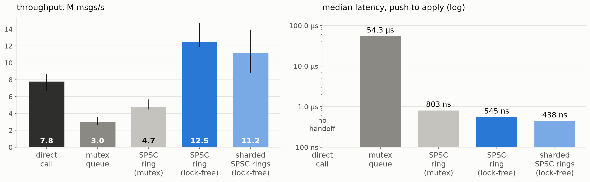

| | direct call | mutex queue | SPSC ring (mutex) | SPSC ring (lock-free) | sharded SPSC rings |
|---|---|---|---|---|---|
| M msgs/s | 7.8 | 3.0 | 4.7 | **12.5** | 11.2 |
| median latency | no handoff | 54 µs | 803 ns | 545 ns | **438 ns** |
| consumer CPU | | 8% | 68% | 64% | 51% per consumer |

Sharded is 2 shards (`instrument_id % 2`); 3 shards measured 10.8 M msgs/s and 496 ns.

### Idle strategies, core to itself

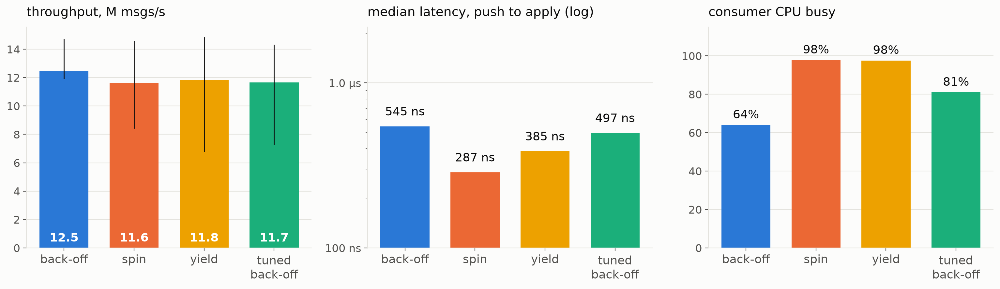

When nothing else wants the consumer's core, `yield()` returns immediately and behaves like spinning (385 ns, 98% CPU).
Spin is fastest (287 ns). The tuned back-off (below) is 497 ns at 81%; the current `BalancedBackoff` 545 ns at 64%.

### Idle strategies, sharing the core

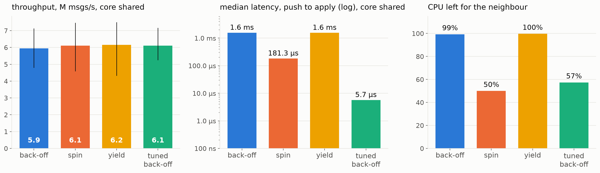

A busy-loop process pinned to each consumer core, same priority, so `yield()` really hands the core away:

| | median | p99 | CPU left for the neighbour |
|---|---|---|---|
| spin | 181 µs | 13 ms | 50% (time-sliced) |
| yield | **1.55 ms** | 12 ms | 100% |
| back-off (`BalancedBackoff`) | 1.56 ms | 14 ms | 99% |
| tuned back-off | **5.7 µs** | 11 ms | 57% |

`yield()` gives the neighbour a whole scheduler time slice (~1.5 ms) before the consumer runs again, and
`BalancedBackoff` spends most of its idle time in 2000 yields, so it behaves the same. With the neighbour at `nice 19`:
spin 304 ns but the neighbour gets 2% of the core; tuned back-off 534 ns and the neighbour keeps 33%; yield and
back-off still ~1.5 ms.

### Tuning the back-off

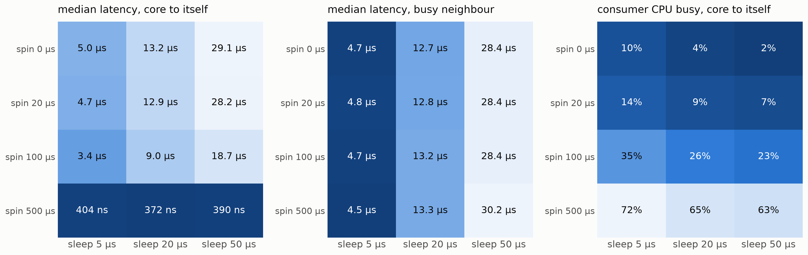

`TimedBackoff` (`Core/Source/Handoff/IdleStrategy.h`, handoff `ring-tuned`) backs off by time instead of counts, so a
schedule means the same on any CPU (`pause` costs ~140 cycles here, `isb` ~9 ns on the M2): spin for S, optionally yield
for Y, then sleep in naps of N, with the thread's timer slack lowered to T (the kernel default of 50 µs turns a 20 µs nap
into ~70 µs). Set with `LOB_BACKOFF=S,Y,N,T` in ns. Sweep on ESZ6 at 240x, 2 runs, full table in
[`idle_sweep.md`](databento/final-demo_data/idle_sweep.md):

- **The spin length sets the latency when the core is free** (500 µs of spin: 0.4 µs median) **and the CPU cost**.
- **The nap length sets the latency when the core is shared** (5 µs naps: ~4.5 µs median whatever the spin).
- **No yield stage.** Adding 200 µs of yields put the shared-core median back at 1.3 ms.
- **Lower the timer slack.** 20 µs naps: 13 µs median with 1 µs slack, 37 µs with the default.
- Tuned default: spin 500 µs, no yield, 5 µs naps, 1 µs slack. A low-CPU alternative is no spin + 5 µs naps:
  5 µs median at 10% CPU with the core to itself.

### When there are more threads than cores

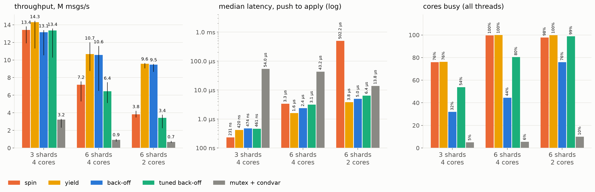

Sharded rings with the producer plus 3 or 6 consumers on 4 or 2 cores, so the threads compete with each other:

| M msgs/s (median latency) | 3 shards, 4 cores | 6 shards, 4 cores | 6 shards, 2 cores |
|---|---|---|---|
| spin | 13.4 (231 ns) | 7.2 (3.3 µs) | 3.8 (502 µs) |
| yield | **14.3** (420 ns) | **10.7** (1.6 µs) | **9.6** (3.8 µs) |
| back-off | 13.1 (474 ns) | 10.6 (2.4 µs) | 9.5 (5.0 µs) |
| tuned back-off | 13.4 (461 ns) | 6.4 (3.1 µs) | 3.4 (6.4 µs) |
| mutex + condvar | 3.2 (54 µs) | 0.9 (43 µs) | 0.7 (14 µs) |

Here the competitors are the pipeline's own threads, and yielding hands the core straight to one with work: yield and
`BalancedBackoff` are best. Spinning (including the tuned back-off's 500 µs spin) burns slices the producer and the other
shards need. Nap-only back-offs are no better: 6 consumers waking every 5 µs collapse to 1–2.5 M msgs/s on 2 cores.

### Which idle strategy

| the consumer's core is... | use | why |
|---|---|---|
| dedicated | spin, or tuned back-off to save ~20% CPU | lowest latency |
| shared with unrelated work | tuned back-off (spin, then short naps, no yield) | yield waits a whole time slice for the core back |
| shared with the pipeline's own threads (more shards than cores) | yield, or `BalancedBackoff` | yield passes the core to a thread that has work |
| precious (power, many idle feeds) | nap-only back-off, or mutex + condvar | 10% / 5% CPU, at 5 µs / 54 µs latency |

---

## Databento path

Everything in this section is the real Databento pipeline (`databento_replay` → `DatabentoSession` →
`mbo::handle_message`) on two CME MBO files from one hour: `esz6` (ESZ6, 163,149 records) and `cme_mix` (ESZ6, NQZ6,
CLX6, GCZ6, ZNZ6, 6EZ6, 1,054,337 records). Every mode, queue type and book ends in the identical book state.
Images are in [`databento/images/`](databento/images/), numbered in talk order, CSVs in [`databento/`](databento/).

```
tools/linux/build_databento.sh       # databento-cpp into vendor/install (needs libssl-dev libzstd-dev)
tools/linux/databento_report.sh      # every step below + images, ~45 min; --only handoff,buffers,placement,latency,books,perf
```

### Handoff designs

| mode | what it is |
|---|---|
| single thread | `DatabentoSession::apply` on the reading thread, no queue |
| mutex + condvar | `Handoff/Mutex/MutexPipeline.h`: `std::queue`, lock + `notify_one` per message, consumer sleeps on the condvar (same design as `ItchMutexDecoder`) |
| locked ring | fixed ring guarded by a mutex (`Core/MutexBuffer.h`), consumer polls with back-off |
| ring | lock-free SPSC `CircularBuffer` with cached counters; consumer waits by yield, spin or back-off |
| sequence ring | `SequencedBuffer`, a sequence number per slot, back-off |
| N shards | one ring + book thread per shard, routed by `instrument_id % N` |

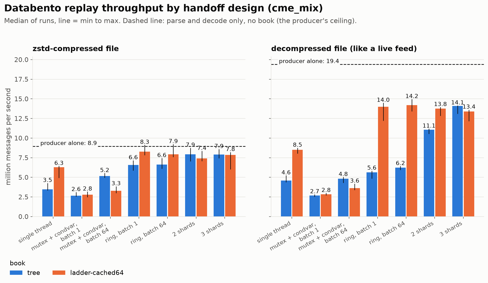

On the decompressed file (what a live feed looks like) with the fast book: single thread 8.5 M msgs/s, ring 14.2,
mutex + condvar 2.8–3.6. The producer alone (read + decode, no book) does 19.4.

- **The lock-free ring is 1.7x a single thread, but only when the book is fast.** With `tree` the consumer is the
  bottleneck and the ring gains little (6.2 vs 4.6); sharding helps it instead (3 shards: 14.1).
- **mutex + condvar is slower than one thread** (2.7–4.8 M msgs/s): a lock, a notify and often a futex wake per message.
- **On the zstd file decompression caps the producer at ~9 M msgs/s** and every threaded design sits under it.

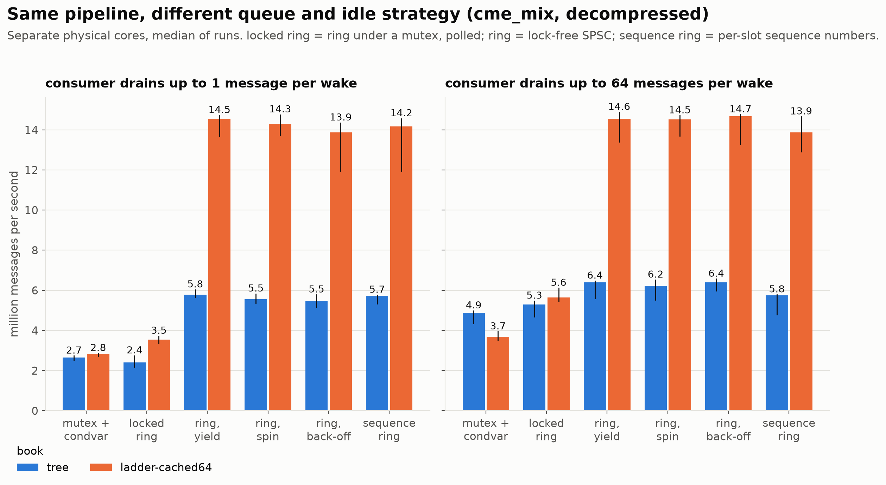

The four lock-free variants are within a few percent of each other on the real pipeline (13.9–14.7 M msgs/s): once
there is real decode and book work, the queue internals stop mattering. The gap is lock-free vs locked (2.4–5.6).

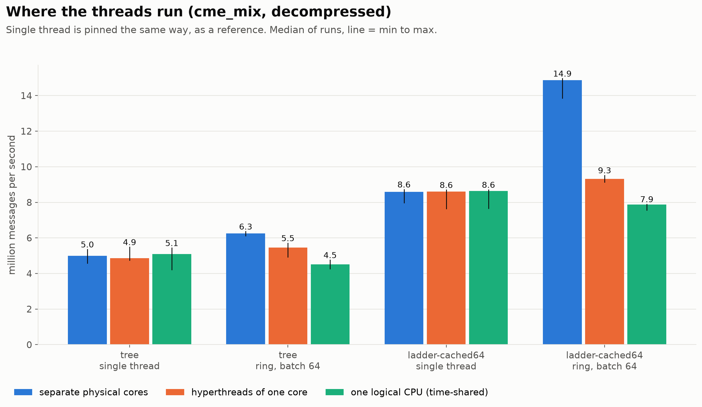

Separate physical cores 14.9, hyperthreads of one core 9.3, one logical CPU 7.9. Databento messages travel by value,
so nothing is allocated on one thread and freed on the other; separate cores win clearly. (The ITCH path, which
passes heap-allocated messages, showed the opposite; see "Hyperthreads" below.)

### Handoff latency

Replay paced at 60x market time on `esz6` (the bursts keep their real spacing), batch 64, separate cores. Latency =
push on the producer to pickup on the consumer.

| queue | median, fast book | median, tree | p90, fast book | consumer CPU |
|---|---|---|---|---|
| ring, spin | **226 ns** | 407 ns | 1.5 µs | 100% |
| ring, yield | 329 ns | 588 ns | 1.5 µs | 100% |
| sequence ring (back-off) | 1.0 µs | 3.8 µs | 66 µs | 42% |
| ring, back-off | 1.7 µs | 4.0 µs | 68 µs | 41% |
| locked ring (back-off) | 2.0 µs | 4.8 µs | 66 µs | 42% |
| mutex + condvar | **70 µs** | 73 µs | 88 µs | **3%** |

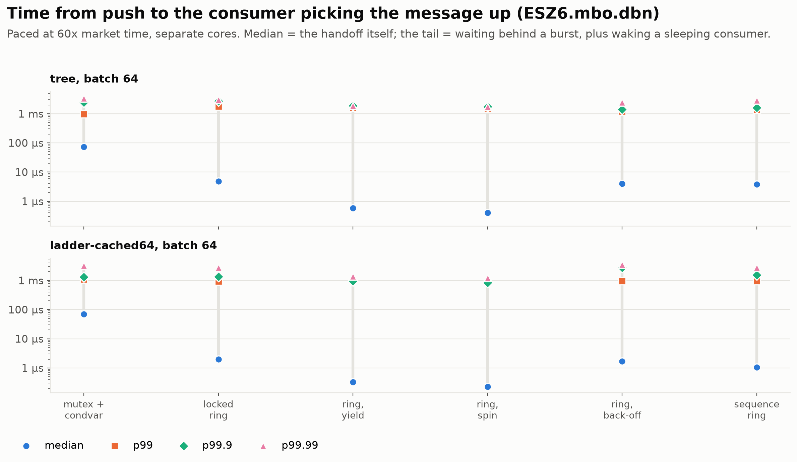
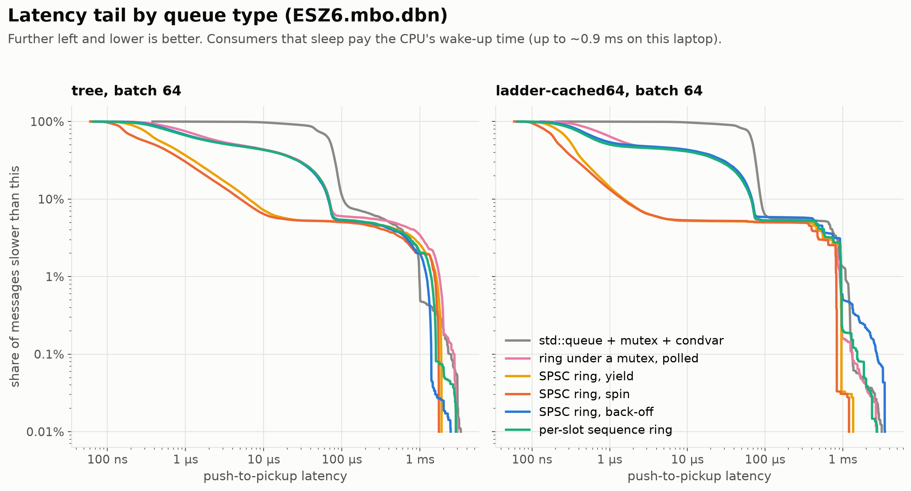
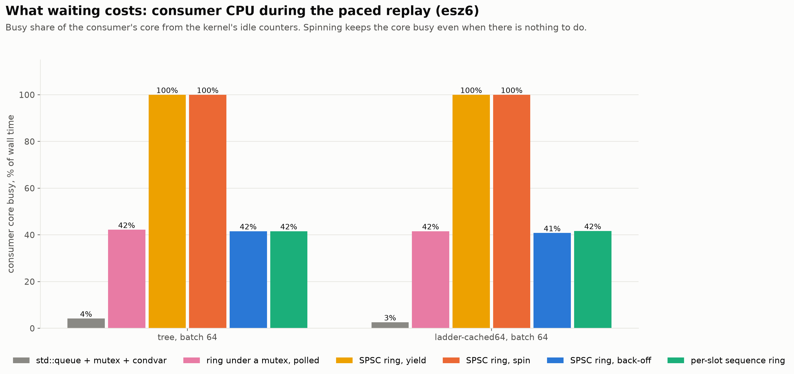

- **The idle strategy decides latency, not the buffer.** Consumers that never sleep (spin, yield) hand off in
  ~0.2–0.6 µs and burn a whole core. Back-off sleeps between bursts: 1–4 µs median, ~66 µs p90 (waking a sleeping
  core), 41% of a core. The condvar sleeps in the kernel: ~70 µs median, 3% of a core.
- **The tail (p99 ≈ 1 ms) is the same for every queue.** It is messages waiting behind the market's biggest bursts:
  the producer decodes faster than the consumer applies. Part of it is the 60x replay compressing the quiet gaps.
  This CPU's deepest idle state takes 890 µs to leave, which shows up in the back-off and condvar tails.
- 240x replay overloaded the consumer (p99 5–14 ms for every queue) and is not used.

### Inner books

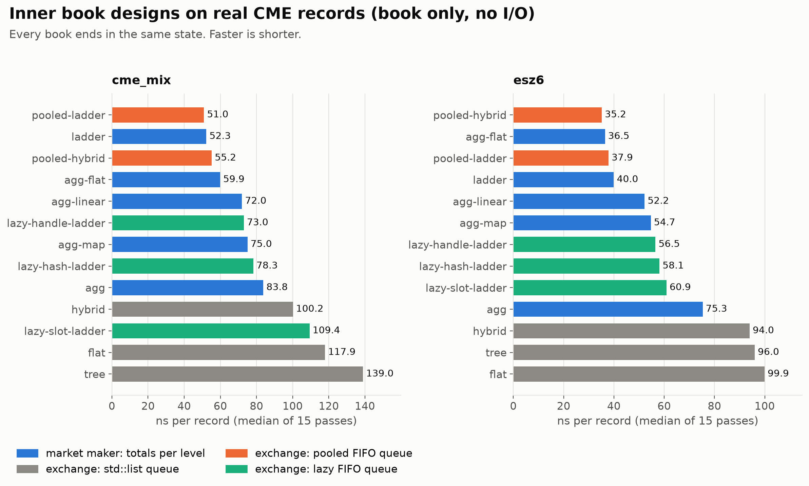
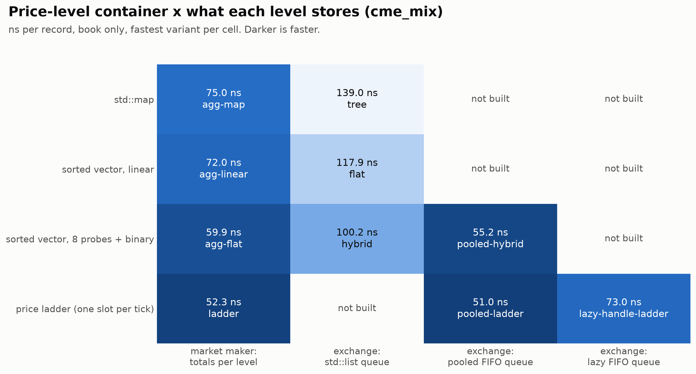

ns per record, book only (`databento_replay ... variants all`, 15 passes): `pooled-ladder` 51, `ladder` 52,
`pooled-hybrid` 55, `agg-flat` 60, `agg-linear` 72, `lazy-handle-ladder` 73, `agg-map` 75, `agg` 84, `hybrid` 100,
`flat` 118, `tree` 139 (`cme_mix`).

- **The exchange book with a pooled FIFO queue keeps every order in time priority and is as fast as the
  market-maker books that keep only totals** (51 vs 52 on `cme_mix`, 35 vs 37 on `esz6`).
- **`std::list` queues cost 2–2.7x.** The level container matters less: with list queues, map vs vector is 139 vs 100.
- The lazy queue is mid-pack and has the worst modify tail (p99 ≈ 1 µs, image 09).

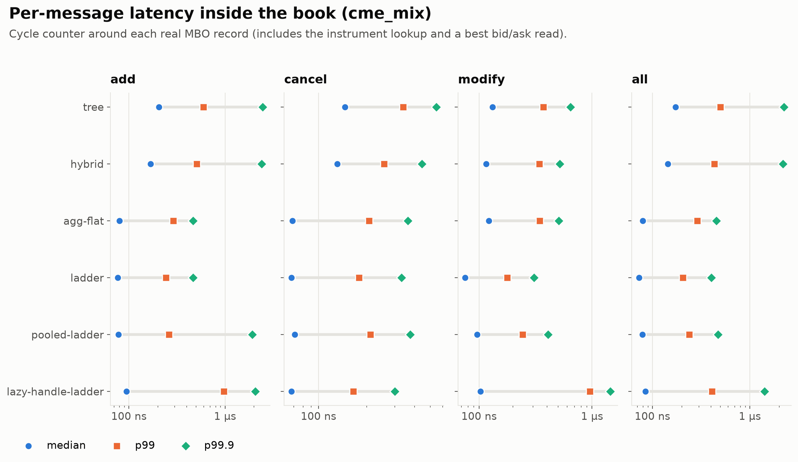

### Every handler x inner book

`tools/linux/databento_combos.sh`: 7 books (all with a 64-slot instrument cache) x 9 handlers. Throughput is flat out
on the decompressed `cme_mix` (5 alternating runs); latency is paced at 60x on `esz6`, batch 64. Full ranked tables in
[`databento/reference/combos_ranking.md`](databento/reference/combos_ranking.md). This matrix ran in one later session where the machine
was about 20% slower overall than the earlier runs, so compare within it, not against the numbers above.

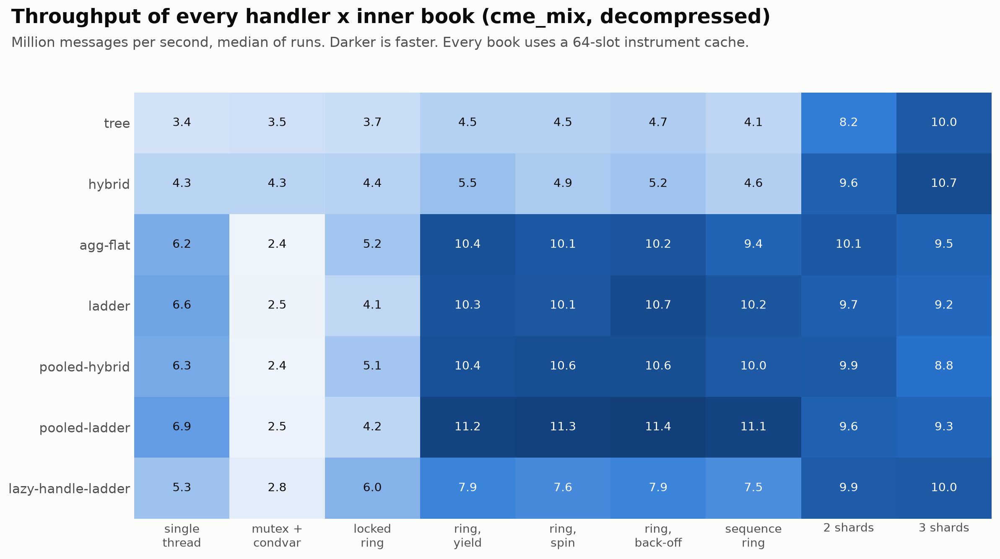
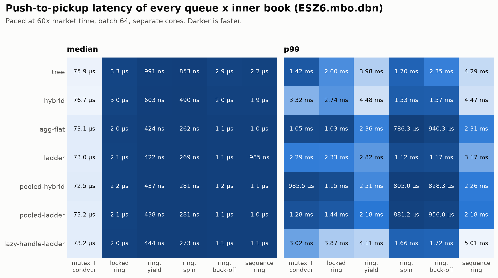
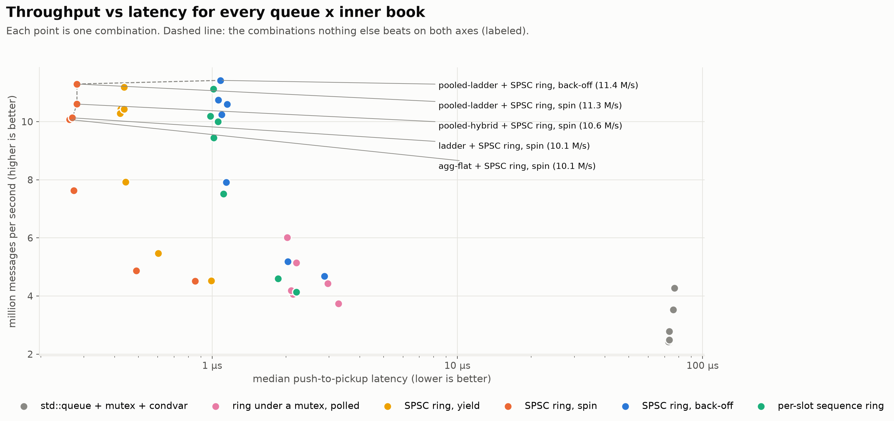

- **Best overall: `pooled-ladder` + SPSC ring.** Highest throughput (11.3–11.4 M msgs/s); with spin also a 281 ns
  median handoff. Nothing beats spin + pooled-ladder on both axes except back-off + pooled-ladder, which trades
  ~0.8 µs of median latency for 0.1 M/s and 59% less consumer CPU.
- **The book decides throughput, the idle strategy decides latency.** Every fast book (`pooled-*`, `ladder`,
  `agg-flat`) lands at 10–11.4 M msgs/s behind any lock-free ring; the queue's median is ~0.3 µs (spin),
  ~0.4 µs (yield), ~1–2 µs (back-off, sequence, locked), ~73 µs (condvar) whatever the book.
- **Slow books need shards, not a faster queue.** `tree` / `hybrid` stay at 3.4–5.5 M msgs/s with any single
  consumer, and reach 10.0–10.7 with 3 shards. For the fast books sharding is slightly worse than one ring.
- **`lazy-handle-ladder`** is the one fast-ish book that gains from sharding (7.9 → 10.0).
- **Worst: mutex + condvar with a fast book** (2.4–2.8 M msgs/s, ~73 µs): the lock and wakeup cost more than the book.

### Why, from perf

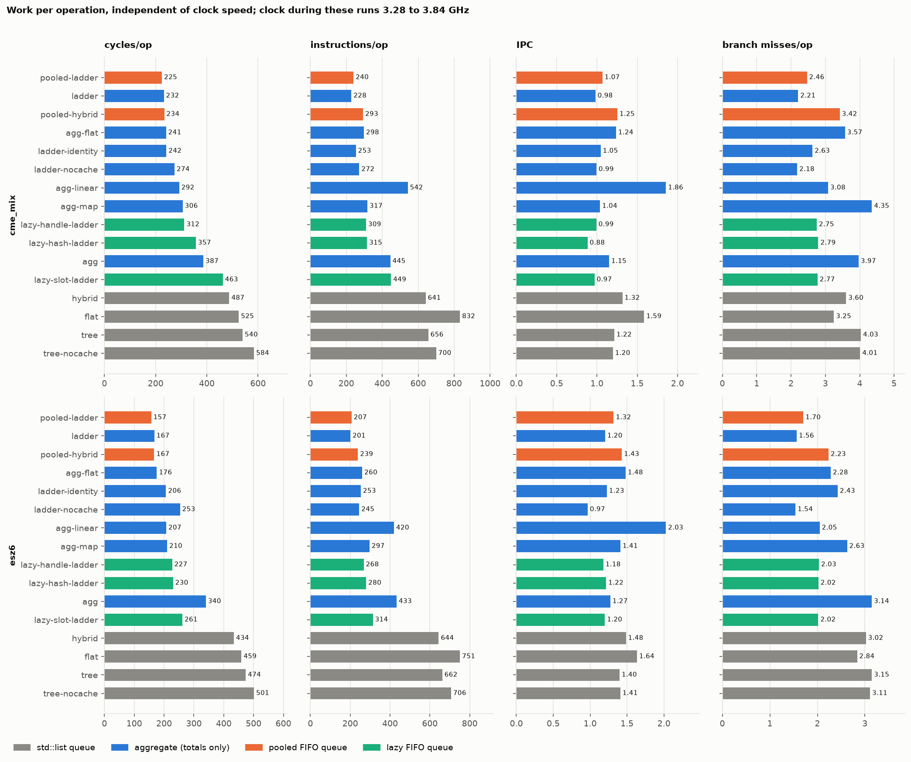
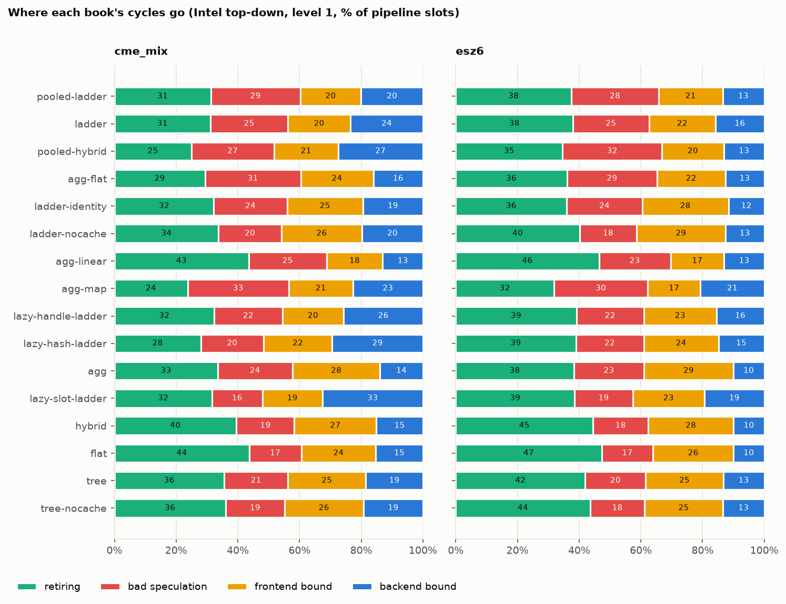
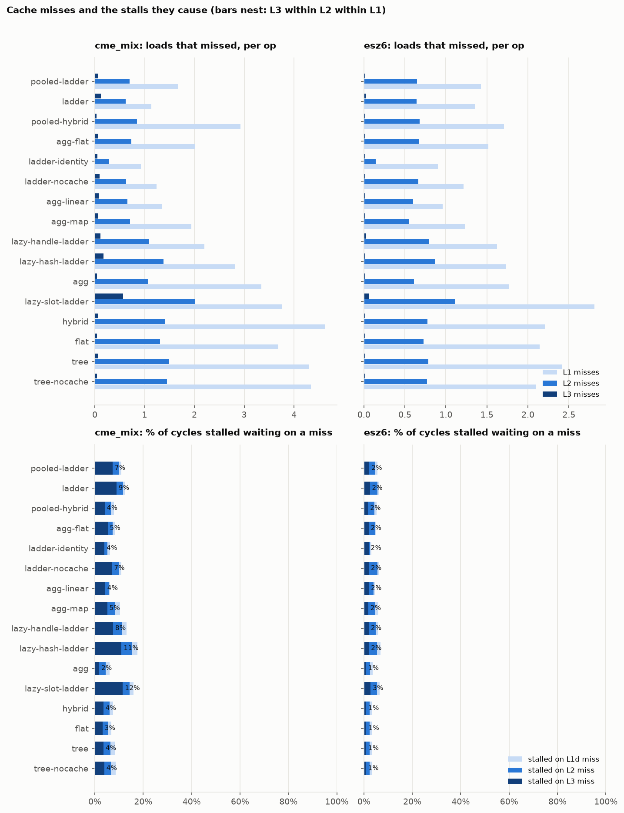
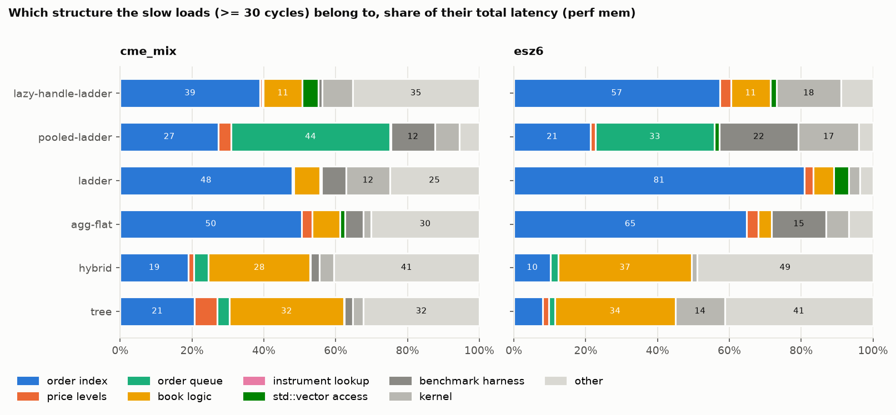
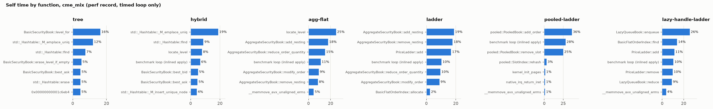

- The list books execute several times the instructions per record of the flat books.
- In the fast books the largest loss is bad speculation (25–32% of pipeline slots), not memory.
- `ladder` / `agg-flat`: 48–81% of slow-load latency is the order index (whole orders in each slot, a big table).
  `pooled-ladder`'s index is 16-byte slots, only 21–27%; its slow loads are the queue unlink instead.

Caveat for all numbers: governor `powersave`, turbo on, the CPU ran at about 2.3 GHz. Absolute ns are higher than on
the M2; the rankings held across repeated runs.

---

## Synthetic book results (ITCH-shaped flow)

### What is compared

Every variant is a `OuterBook<SecurityBookT, CacheSlots>` driven through `book_for(instrument)`, the same path
`databento_replay` uses. All of them replay the identical sequence of operations. The registry is in
`Core/Source/BookVariants/BookVariants.h`.

| name | price levels | order index | how orders are stored |
|---|---|---|---|
| `tree` | `std::map` | node `std::unordered_map` | `std::list` per level |
| `flat` | sorted vector, linear scan from the touch | node | list |
| `hybrid` | sorted vector, 8 linear probes then binary | node | list |
| `agg` | hybrid vector of `{quantity, count}` | node | aggregate: the order lives only in the index |
| `agg-flat` | hybrid vector | open addressing | aggregate |
| `ladder` | `PriceLadder`, one slot per tick | open addressing | aggregate |
| `ladder-identity` | ladder | open addressing, identity hash | aggregate |
| `pooled-hybrid` | hybrid vector of level slots | open addressing | intrusive FIFO per level, all orders in one vector |
| `pooled-ladder` | ladder of level slots, tick passed in | open addressing | intrusive FIFO |

All of the above use a 64-slot instrument cache. `tree-nocache`, `ladder-nocache` and `ladder-cache1` vary only the
cache.

The two `pooled-*` books (`Core/Source/Book/InnerBook/Exchange/PooledBook.h`) test one question: what does keeping the real
per-level order queue cost, if it costs no allocations? Each order is a node in one pooled vector, linked into its
level by 32-bit indices, so a delete is an O(1) unlink.

Every timed operation also reads `best_bid()` / `best_ask()`, the way a strategy would after each update. A hash of
those reads plus the final 10-level depth is each run's checksum. **Every variant produced the same checksum in every
scenario**, and `BookVariants.EveryVariantMatchesTreeOnGeneratedFlow` checks the same thing op by op against `tree`.

### Scenarios

The ITCH fixture can't tell these structures apart: 50 fixed levels, and no order is ever removed. So `book_bench`
generates its own flow (`Core/Source/BookVariants/OrderFlow.cpp`):

- each instrument has a fair price that steps one tick with probability `--move` per step. The level it crosses is
  cleared: 2 orders execute, the rest are pulled (quotes fading).
- adds land at a geometric distance from the fair price (`--near-touch`), with `--far-fraction` of them 20 to
  `--far-ticks` ticks away
- 85% of cancels and replaces hit the 64 newest orders (`--recent-cancel`): short-lived quotes, like a real feed
- book size is held near `--resting` orders per instrument

The default mix is about 42% add, 37% delete, 9% execute, 7% partial cancel and 5% replace, with the BBO changing on
about 4% of ops. 2M timed operations per scenario.

| scenario | setup | what it stresses |
|---|---|---|
| `equity` | 5,000 resting, 1 instrument | baseline |
| `thin` | 500 resting | everything in L1/L2 |
| `deep` | 50,000 resting | index and order storage spill out of L2 |
| `volatile` | touch moves 5x as often, denser levels | level create/erase at the touch |
| `wide` | 5% of adds 20..5,000 ticks away | sparse far levels (ladder size, vector shifts) |
| `cme6` | 6 instruments x 5,000, interleaved | like the six-instrument CME hour |
| `multi` | 64 instruments x 2,000, interleaved | cross-book cache pressure, 64-slot cache collisions |
| `random_ids` | random 63-bit order ids | hash behavior without sequential ids (CME-style) |

### Throughput

Median ns per operation over 5 runs (lower is better). Each run is its own process pinned to CPU 1.

| | equity | thin | deep | volatile | wide | cme6 | multi | random_ids |
|---|---|---|---|---|---|---|---|---|
| `tree` | 135 | 110 | 127 | 125 | 138 | 151 | 354 | 138 |
| `flat` | 138 | 110 | 135 | 127 | 147 | 147 | 322 | 127 |
| `hybrid` | 136 | 111 | 129 | 125 | 144 | 150 | 323 | 137 |
| `agg` | 103 | 96 | 93 | 95 | 115 | 110 | 225 | 111 |
| `agg-flat` | 57 | 51 | 48 | 43 | 62 | 58 | 114 | 59 |
| `ladder` | 48 | 42 | 46 | 43 | 50 | 54 | **107** | 51 |
| `ladder-identity` | 62 | 51 | **195** | 62 | 64 | 52 | 109 | 52 |
| `pooled-hybrid` | 48 | 42 | 46 | 41 | 55 | 55 | 115 | 53 |
| `pooled-ladder` | **45** | **39** | **41** | **41** | **46** | **48** | 116 | **49** |

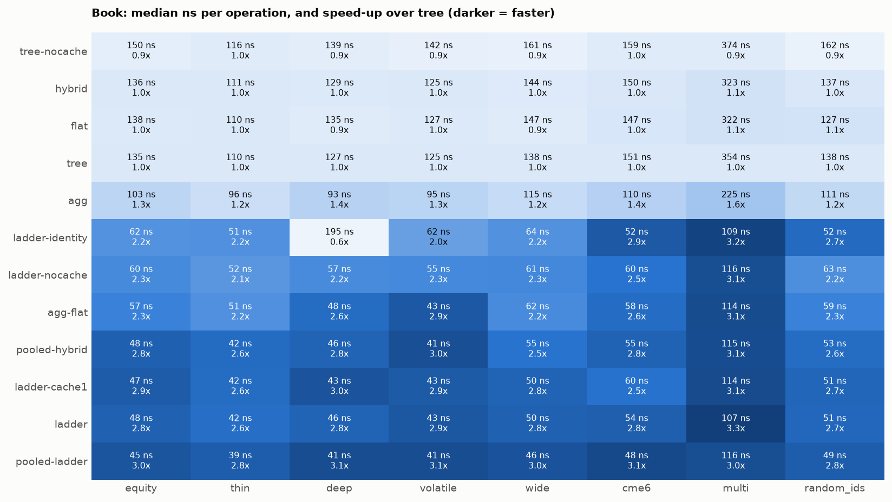

Per-scenario bars: [equity](reference/book_equity.png) · [thin](reference/book_thin.png) · [deep](reference/book_deep.png) ·
[volatile](reference/book_volatile.png) · [wide](reference/book_wide.png) · [cme6](reference/book_cme6.png) · [multi](reference/book_multi.png) ·
[random_ids](reference/book_random_ids.png)


### Latency per operation

Cycle counter around every operation, including `book_for` and the BBO read. ns, `equity`:

| | p50 | p90 | p99 | p99.9 |
|---|---|---|---|---|
| `tree` | 162 | 257 | 437 | 739 |
| `hybrid` | 131 | 214 | 347 | 551 |
| `agg` | 105 | 180 | 297 | 468 |
| `agg-flat` | 72 | 119 | 208 | 328 |
| `ladder` | 69 | 105 | 174 | 274 |
| `ladder-identity` | 69 | 129 | 234 | 406 |
| `pooled-hybrid` | 64 | 111 | 207 | 326 |
| `pooled-ladder` | **63** | **90** | **154** | **248** |

`deep` (50,000 resting orders):

| | p50 | p90 | p99 | p99.9 |
|---|---|---|---|---|
| `tree` | 155 | 260 | 487 | 813 |
| `agg-flat` | 68 | 135 | 237 | 418 |
| `ladder` | 68 | 102 | **189** | **357** |
| `ladder-identity` | 66 | 304 | **2,493** | **20,221** |
| `pooled-ladder` | 70 | 148 | 309 | 470 |

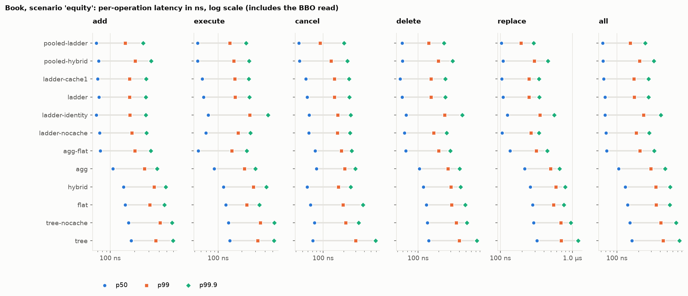
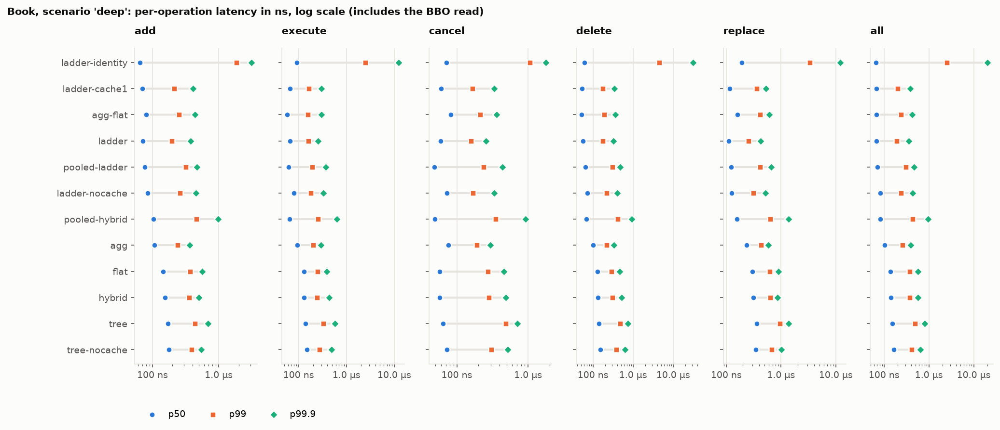

### Instrument cache

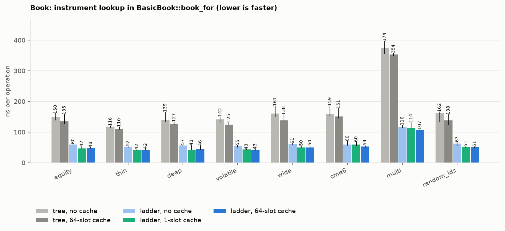

### What the book numbers say

- **The order index is still the biggest lever.** `agg` → `agg-flat` (node hash map → open addressing) saves ~45 ns in
  every scenario, the largest single step in the table. The same ranking as the CME hour on the Mac.
- **With the node index, the level structure doesn't matter.** `tree`, `flat` and `hybrid` are all 110–150 ns: the
  node hash map and the `std::list` allocations hide the level search. Level storage only shows up once the index is
  fast (`agg-flat` 57 → `ladder` 48).
- **`ladder-identity` breaks on deep books.** At 50k orders its median is 195 ns, its p99 2.5 µs and its p99.9 20 µs,
  13x and 57x worse than `ladder`. Sequential ids with an identity hash fill one contiguous run of the table, and
  every miss or insert walks it. The CME hour showed the start of this; a deep book makes it a tail-latency problem.
  Drop it, or use a real mixing hash.
- **Keeping the full queue costs nothing measurable.** `pooled-ladder` keeps every order in time priority, like
  `tree`, yet beats the aggregate `ladder` in 7 of 8 scenarios (by 2 to 6 ns) and has the lowest p99 in `equity`. The
  aggregate design isn't needed for speed: pooled nodes, index links and a flat index get the same result while
  keeping order-by-order depth.
- **Where pooled loses: `multi` (116 vs 107) and the deep tails (p99 309 vs 189).** The order nodes are a second
  memory region next to the index, so with 64 books or 50k orders there are more cache misses per op. Per-op hardware
  counters would show this directly (see [How the measurements work](#how-the-measurements-work)).
- **Instrument cache:** for `ladder`, going from no cache to 64 slots saves ~12 ns per op in every scenario. With 64
  instruments, a 1-slot cache is about the same as none (the instrument nearly always changes), and 64 slots wins by
  ~8 ns. `tree` gains ~15 ns from the cache, about the same absolute amount.
- **`multi` doubles everything.** 64 books x 2,000 orders don't fit in L2 (1 MB here), so most ops miss to L3. All
  the fast books land at 107–116 ns: memory decides there, not the data structure.

---

## Queue results

Every test runs three ways:

- **unpinned**: the scheduler decides
- **cross_core**: producer on CPU 1, consumer on CPU 2 (two physical cores; cache lines move through L3)
- **smt**: producer on CPU 1, consumer on CPU 5 (two hyperthreads of one core, sharing L1/L2)

### Buffers, flat out (M items/s, median of 5)

| buffer | unpinned | cross_core | smt |
|---|---|---|---|
| ring, uncached counters | 74 | 62 | 105 |
| ring, cached counters (`CircularBuffer`) | 134 | 141 | 145 |
| ring, per-slot sequence (`SequencedBuffer`) | 218 | **331** | 162 |
| Vyukov MPMC | 56 | 56 | 47 |


### Buffers, paced (p50 / p99 ns)

| buffer | 100k/s cross_core | 100k/s smt | 1M/s cross_core | 1M/s smt |
|---|---|---|---|---|
| ring, uncached counters | 216 / 6,064 | 77 / 114 | 167 / 2,353 | 71 / 107 |
| ring, cached counters | 176 / 6,921 | 79 / 110 | 125 / 2,460 | 74 / 113 |
| ring, per-slot sequence | 189 / 8,157 | 81 / 169 | 154 / 6,623 | 73 / 115 |
| Vyukov MPMC | 192 / 7,032 | 93 / 168 | 159 / 640 | 80 / 115 |

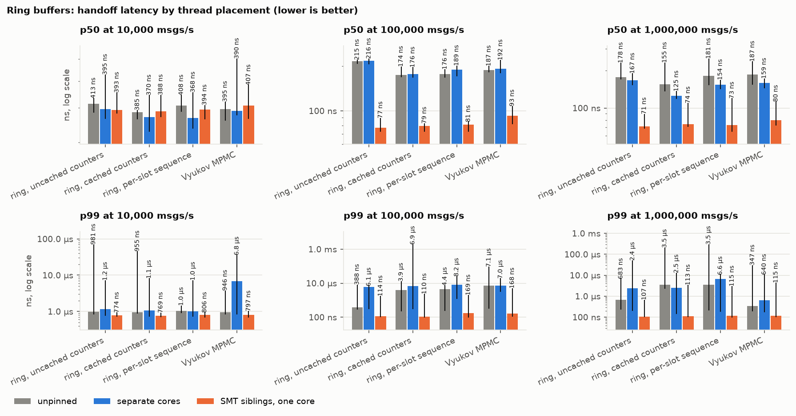

### Idle strategies (on the cached-counter ring; mutex for reference)

| | flat out cross / smt (M/s) | p50 / p99 at 10k/s, cross | p50 / p99 at 1M/s, cross | consumer CPU |
|---|---|---|---|---|
| mutex + condvar | 4 / 6 | 3,658 / 372,302 | 2,266 / 7,906 | 3% at 10k/s, 65% at 1M/s |
| yield | **210 / 367** | 394 / 3,018 | 345 / 728 | 100% |
| spin | 86 / 298 | **196 / 574** | **140 / 216** | 100% |
| back-off (`BalancedBackoff`) | 88 / 239 | 412 / 1,381 | 137 / 212 | 100% |

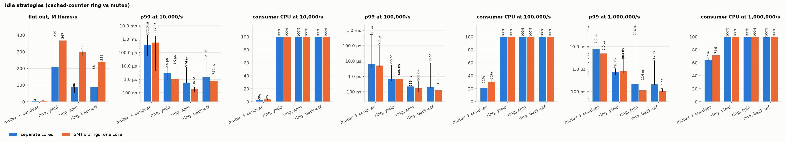

### One producer, N consumers (M items/s)

| consumers | sharded uncached rings | sharded cached rings | sharded sequence rings | MPMC |
|---|---|---|---|---|
| 1 | 51 | 74 | 84 | 67 |
| 2 | 37 | 44 | 50 | 11 |
| 4 | 36 | 48 | 35 | 9 |

### What the queue numbers say

- **Across cores the per-slot sequence ring wins** (331 M/s, 2.3x the cached ring), the same result as on the M2.
- **On hyperthreads the ranking flips**: the sequence ring halves to 162 M/s while the others speed up. See
  [its section](#4-per-slot-sequence-ring-sequencedbuffer) for the likely reason.
- **Hyperthreads halve the handoff latency** (p50 ~75 ns vs ~170 ns) and collapse the p99 from microseconds to ~110 ns,
  because a handoff stays inside one core's L1. The catch is that the two threads share one core's execution units.
- **The cross-core p99 of several µs is mostly the OS** (timer interrupts and scheduler on a laptop), not the queue. It
  barely depends on which buffer is used.
- **Spin vs back-off:** identical at ≥100k/s. At 10k/s back-off has already moved to yielding, so its p99 is 1.4 µs
  against spin's 574 ns. Neither ever reached the sleep stage, so both burned 100% CPU. Only the mutex saves CPU.
- **More consumers only made it slower**, as on the Mac: one producer is the limit, and MPMC collapses at 2 consumers.

---

## How each queue works

All of these pass items from a producer thread to a consumer thread. What separates them is how often a cache line
has to move between the two cores: roughly 50–100 ns per move across cores here, much less between hyperthreads.

### 1. Mutex + condition variable (`MutexQueue`, `Core/ItchMutexDecoder`)
A `std::queue` behind a `std::mutex`. Push takes the lock, pushes, then calls `notify_one`. Pop sleeps on the
condition variable until something arrives.
- **Good:** it's the only queue that truly sleeps when idle (3% CPU at 10k/s versus 100% for every ring). It's
  simple, and any number of producers or consumers work.
- **Bad:** every op is a lock and an unlock, and waking a sleeping consumer is a system call plus a scheduler wakeup.
  That gives 4–6 M/s, a 2–4 µs median, and a 370–560 µs p99 at 10k/s, when the consumer is deep asleep. The deque also
  allocates as it grows.

### 2. Ring with uncached counters (`UncachedIndexBuffer` in `Core/Test/QueueBench.cpp`)
A fixed array plus two atomic counters, `head_` (consumer) and `tail_` (producer), each on its own cache line.
- **Good:** no locks, no allocation, and each side writes only its own counter.
- **Bad:** each side reads the other's counter on every op to check full or empty. So every push pulls the consumer's
  line over and every pop pulls the producer's line back: one line move per item. 62 M/s across cores. It's faster on
  hyperthreads (105 M/s) because there the "move" stays inside the shared L1.

### 3. Ring with cached counters (`CircularBuffer`, used by `MessagePipeline`)
The same ring, but each side keeps a private copy of the other's counter (`head_cache_`, `tail_cache_`) and only
re-reads the real one when its copy says the ring is full or empty.
- **Good:** if the producer is 1,000 slots ahead, the consumer reads `tail_` once and then pops 1,000 items without
  touching the producer's line: 141 M/s across cores, 2.3x the uncached ring. `pop_batch` builds on this: read
  `tail_` once, consume a run, store `head_` once.
- **Bad:** when the consumer keeps up and the ring is nearly empty, which is the normal case at real feed rates, the
  copy always says "empty" and it re-reads `tail_` every pop. Under light load it degrades to the uncached ring. The
  data slots themselves still cross cores, which is unavoidable.

### 4. Per-slot sequence ring (`SequencedBuffer`)
There are no shared counters at all. Each slot holds `{sequence, value}`. The producer checks that
`slot.sequence == tail`, writes the value, then publishes with `sequence = tail + 1`. The consumer waits for
`sequence == head + 1`, then frees the slot with `head + Capacity`.
- **Good:** the "ready" flag sits in the same cache line as the data, so one line transfer carries both, and neither
  side ever reads the other's position. The fastest across cores, here and on the M2.
- **Bad:** the slowest on hyperthreads (half its cross-core speed). The likely cause, not yet measured: the two threads
  share one core's pipeline, and the consumer reads exactly the line its sibling is storing to. Intel cores throw away
  in-flight work and restart when a load races a store from the other thread on the same line (a "memory ordering
  machine clear"). `perf stat -e machine_clears.memory_ordering` will confirm or refute it. Each slot also carries
  8 bytes of sequence, so fewer items fit per line.

### 5. Vyukov bounded MPMC (`MpmcQueue`)
Per-slot sequences like #4, plus shared `enqueue_pos` / `dequeue_pos` counters that producers and consumers claim with
compare-and-swap.
- **Good:** the only queue here where *any* consumer can take *any* item, so it's correct with several of each. Decent
  tails at 1M/s (p99 640 ns across cores).
- **Bad:** even with one consumer, every op is a locked atomic read-modify-write, which acts as a full fence: 56 M/s.
  With two consumers they fight over `dequeue_pos`, the CAS keeps failing and the line ping-pongs (67 → 11 M/s). It's
  also wrong for a book: two consumers could apply messages for one instrument out of order. That's why
  `ItchShardedDecoder` routes by instrument through separate SPSC rings instead.

### Idle strategies (`Core/Source/Handoff/IdleStrategy.h`)
What a side does when the ring is empty or full. This matters as much as the queue:

| strategy | how it waits | effect |
|---|---|---|
| yield | `sched_yield()` system call | Best flat out: each syscall takes the waiter off the shared line for a while. The worst p50 under load (~350 ns) |
| spin | the `pause` instruction (~140 cycles on Skylake-derived cores) | Lowest latency, 100% CPU. Worst flat out, because the spinner keeps stealing the line from the side doing real work |
| back-off | spin N, then yield M, then sleep 20 µs | Equals spin at high rates. Slower once it reaches the yield stage. Only saves CPU once it reaches the sleep stage |

x86 note: `cpu_pause()` is `isb` on ARM and `pause` on x86. `pause` costs ~140 cycles here versus ~9 ns for `isb` on the
M2, so `BalancedBackoff`'s 256 spins last several times longer on this CPU.

## Profiling with perf

`tools/linux/profile.sh` (about 25 min) writes everything below to [`perf/`](perf/), with tables in
[`perf/summary.md`](perf/summary.md). No code was added for it: every step runs the release binaries under `perf`. The
only hook is `book_bench`'s existing counter gate (`LOB_PERF_CTL_FD`), so book numbers cover the timed loop only.
`tools/plot_linux_perf.py benchmarks/linux/perf` redraws the charts from the CSVs on any machine.

| step | perf command | what it gives |
|---|---|---|
| `book` | `perf stat -D -1 --control fd:...` in 5 groups of at most 4 hardware events | cycles, instructions, branch misses, top-down slots, L1/L2/L3 misses, miss stalls, per op |
| `queue` | `perf stat -C <producer>,<consumer> -A` | the same counters split by CPU, so producer and consumer separate, since each is pinned |
| `mem` | `perf record -e cpu/mem-loads,ldlat=30/P -d -W`, then `perf script -F data_src,weight,srcline` | every sampled load >= 30 cycles, the level that served it, and the class it belongs to (`tools/linux/perf_mem_sources.py`) |
| `cpu` | `perf record --call-graph lbr` | self time per function; full stacks in [`perf/profiles/`](perf/profiles/) for https://profiler.firefox.com |
| `clock` | `perf stat -I 250 -e cycles,ref-cycles` | effective clock every 250 ms |

Groups are capped at 4 hardware events because the NMI watchdog holds a counter. No count in the CSVs was time-sliced
(every row is counted 100% of the time). Needs `sudo sysctl kernel.perf_event_paranoid=0`.

### Clock
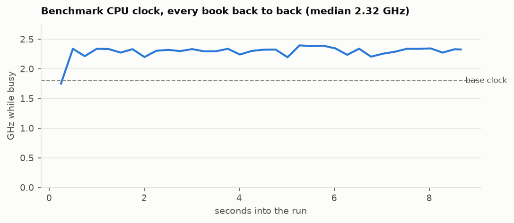

The governor held this CPU at ~2.3 GHz throughout (base 1.8, turbo 4.9), with no throttling. This, plus core design, is
the gap to the Mac: `ladder` takes 145 cycles/op here, which is 63 ns at 2.3 GHz; the M2's 18.8 ns at ~3.5 GHz is about 66
cycles. So the M2 does the same op in under half the cycles and also runs at 1.5x the clock. Compare books across
machines in cycles, not ns.

### Work per operation
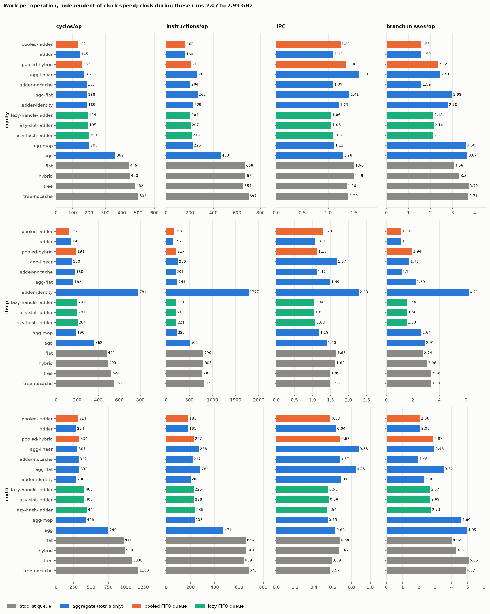

- `tree` / `flat` / `hybrid` execute 650–800 instructions per op; `ladder` and `pooled-ladder` ~160. The fast books do
  a quarter of the work, not the same work faster.
- `pooled-ladder` is the cheapest in `equity` (132 cycles) and `deep` (127), with the same instruction count as
  `ladder` and higher IPC.
- `ladder-identity` in `deep`: 1,777 instructions per op at IPC 2.28. It runs fast but does 11x the work: it walks the
  long probe runs that sequential ids leave in an identity-hashed table.

### Where the cycles go (top-down)
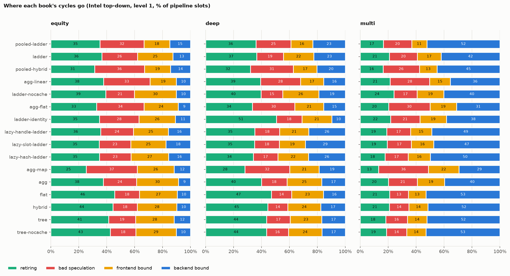

- In `equity` and `deep` the fast books are not memory-bound (backend 9–23%). Their largest loss is **bad
  speculation, 19–37% of slots**, from 1.5–3.7 mispredicted branches per op. Part of that is the benchmark's `switch`
  on a random op type, which a feed handler also has.
- In `multi` everything becomes memory-bound: backend 31–53%. With 64 books the working set leaves the 1 MB L2.

### Misses and stalls
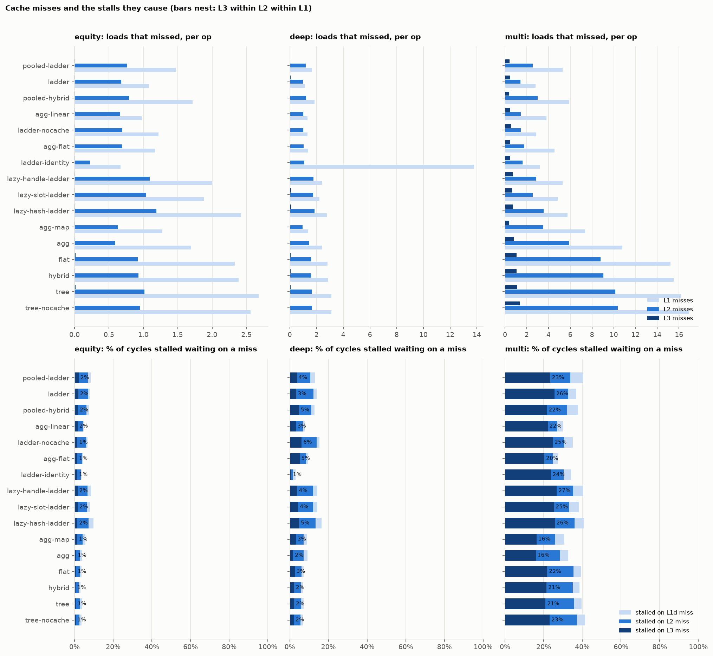

In `multi` the list books miss ~15 times per op in L1 and ~10 in L2; `ladder` ~3 and ~1.5. The lazy books miss about
twice as often as `ladder` in `equity`, which is the cost of the second write per add.

### Which structure the slow loads belong to
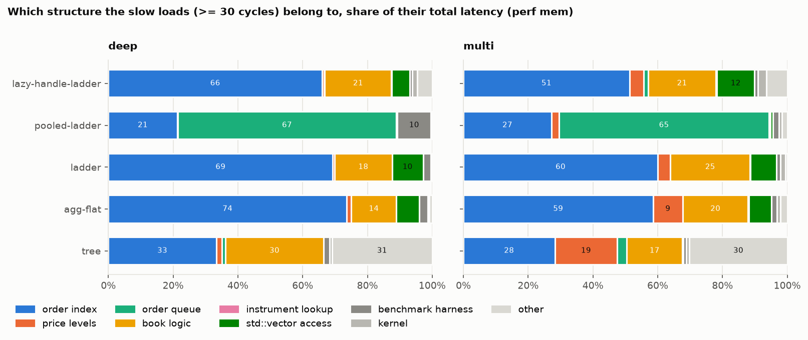

- **`ladder` / `agg-flat`: 60–74% of slow-load latency is the order index.** Their index stores the whole order in each
  slot (~32 bytes), so the table is large and probing it misses L3.
- **`pooled-ladder`: only 21–27% is the index** (16-byte slots: id + order slot). Its slow loads move to the order
  nodes (65–67%, unlinking `prev` / `next` in `remove_slot`). That is why it misses L3 less than `ladder` in `deep`.
- `tree` spreads its latency across the hash map, the `std::map` levels and list nodes.

### Hot functions
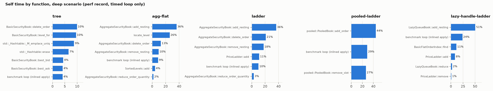

`perf annotate` on `lazy-handle-ladder`'s `add_resting` (51% of its time) puts 58% of that function on one load:
`slots_[slot].key` in `BasicFlatOrderIndex::find` (`OrderIndex.h:82`), the duplicate-id check before inserting. Another
6.6% is an `idivq`: the `(price - base_) / tick_` that appears 8 times across `PriceLadder`, `PooledBook` and
`LazyQueueBook`. A 64-bit divide is ~40–90 cycles on this core; a precomputed reciprocal, or a shift when the tick is a
power of two, would remove it.

### Queues, producer and consumer separately
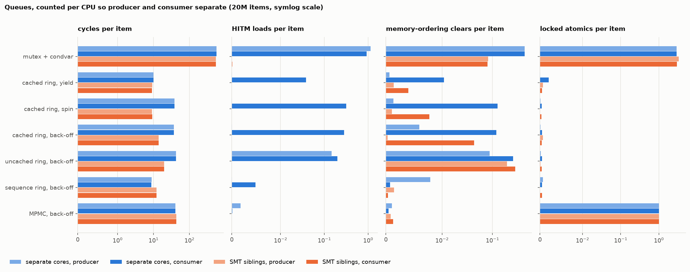

- mutex: ~1 HITM and ~2.5 locked atomics per item (lock, unlock, notify), plus memory-ordering clears.
- MPMC: exactly 1 locked atomic per item on each side (the compare-and-swap), hence a constant ~43 cycles.
- cached-counter ring: 0 HITM on the producer, ~0.3 on the consumer (it keeps re-reading `tail_` while it keeps up).
  The sequence ring cuts that about 10x.
- On SMT siblings HITM drops to 0, and the cost shows up as memory-ordering clears instead (mostly the uncached ring).
- An earlier guess, that the sequence ring halves on SMT because of machine clears, is wrong: it takes ~0.002 clears
  per item, and costs 12.2 cycles per item on SMT vs 10.9 across cores.

## Hyperthreads: same core or separate cores?

Sharing a core means sharing L1/L2, so data crosses for free. It also means sharing the core's issue width, reorder
buffer, branch predictor and cache capacity. The ITCH ring decoder (`bench 10 testdata/queue_1000000.bin`, 1.5M
messages, median of 5, counted per CPU) shows which effect wins:

| placement | M msgs/s | cycles/msg | instructions/msg | HITM/msg | context switches |
|---|---|---|---|---|---|
| separate cores (`taskset -c 2,3`) | 1.20 | 4,182 | 4,009 | 7.78 | 134,338 |
| SMT siblings (`taskset -c 2,6`) | 1.64 | 3,194 | 3,298 | 0.00 | 87,050 |
| one logical CPU (`taskset -c 2`) | **2.62** | **1,209** | **2,124** | 0.00 | 2,368 |

- Across cores each message costs ~8 cache-line transfers. The `unique_ptr<Message>` is allocated on the parser
  thread and freed on the handler thread, so the message, the ring slot and malloc's bookkeeping all bounce.
  Instructions nearly double from the waiting.
- SMT siblings remove the transfers, so they beat separate cores by 37%.
- One CPU wins: the consumer yields when the ring is empty, the producer fills a big batch, they swap. It is a
  single thread with batching and no coherence traffic. Each message is ~1,200 cycles of real work, too little to
  split across threads.

SMT helps when the handoff is the bottleneck: little work per item, a lot of data crossing (this decoder; the queue
tests, where SMT halved p50 and collapsed p99). It hurts when both threads do real work, because they compete for one
core: a core running two busy hyperthreads typically gives 1.0–1.3x one thread's throughput, against ~2x for two
cores. The book in `multi` is already memory-bound, and a parser or zstd on the same core halves its cache.

So: first stop the allocation crossing threads (messages by value), which should bring HITM/msg down toward the
ring's ~0.3. Then run producer and consumer on separate physical cores with the siblings idle (`isolcpus`, or SMT off).
Decide placement with two numbers: HITM per message and IPC. Apple's cores have no SMT, so this only applies to x86.

---

## How the measurements work

### Pinning each thread to a CPU (`Core/Test/QueueBench.cpp`)
`taskset` pins a whole process, so each thread pins itself instead:

```cpp
void pin_current_thread(std::size_t slot)
{
    static const std::vector<int> cpus = pinned_cpus();   // parsed from LOB_CPUS="1,5"
    if (cpus.empty()) return;
    cpu_set_t set;
    CPU_ZERO(&set);
    CPU_SET(cpus[slot % cpus.size()], &set);
    pthread_setaffinity_np(pthread_self(), sizeof(set), &set);
}
```

The producer uses slot 0 and the consumer slot 1, so `LOB_CPUS=1,5 queue_bench one sequenced 20000000` puts the
producer on CPU 1 and the consumer on CPU 5. In fanout mode, consumers take slots 1..N. Without `LOB_CPUS` nothing is
pinned, which also keeps it a no-op on macOS.

### Finding hyperthread pairs (`tools/linux/common.sh`)
The kernel publishes the CPU layout in `/sys/devices/system/cpu/cpuN/topology/thread_siblings_list` (`1,5` on this
CPU). `setup_cpus` picks:

- `PRIMARY_CPU=1` (avoiding cpu0, which handles most interrupts)
- `CROSS_CPU` = the first CPU not on cpu1's core
- `SMT_CPU` = cpu1's other hyperthread

All three can be overridden by environment variables. Fanout fills physical cores before hyperthreads
(`physical_first_cpus`).

### Is perf allowed?
`/proc/sys/kernel/perf_event_paranoid`: ≤1 means everything, 2 means only your own user-space code, 3–4 (Ubuntu's
default) means nothing. At level 2 the scripts add `:u` to every event (`cycles:u`) so perf counts only user-space
code, which is all that level allows. At 3–4 they skip perf and print the command that enables it.

### Which events
`task-clock, context-switches, cycles, instructions, branch-misses, L1-dcache-load-misses, LLC-loads,
LLC-load-misses`, plus `mem_load_l3_hit_retired.xsnp_hitm` and `dTLB-load-misses` when `perf list` shows the CPU has
them.

The important one for queues is **HITM** ("hit modified"): loads that found their line modified in another core's
cache. That is exactly the line bouncing that separates rings #2, #3 and #4, so per item the uncached ring should be
highest and the sequence ring lowest.

### Counting only the timed loop (`book_bench`)
Plain `perf stat` would also count loading the ~80 MB flow file, the warm-up and the teardown. perf has a control
channel for this: start with counters disabled (`-D -1`) and let the program switch them on and off through a pipe.

Shell side (`perf_stat_gated` in `tools/linux/common.sh`):

```bash
mkfifo "$dir/ctl" "$dir/ack"
exec {ctl}<> "$dir/ctl"; exec {ack}<> "$dir/ack"
LOB_PERF_CTL_FD=$ctl LOB_PERF_ACK_FD=$ack \
  perf stat -x, -e "$(perf_events)" -o "$out" -D -1 --control "fd:$ctl,$ack" -- taskset -c 1 book_bench ...
```

Program side (`PerfCounters` in `Core/Test/BookBench.cpp`):

```cpp
perf_counters().enable();          // write(ctl_fd, "enable\n"), then wait for perf's "ack"
for (...) { apply(book, op); hash = observe(...); }
perf_counters().disable();         // write(ctl_fd, "disable\n")
```

Without the environment variables these calls do nothing. `queue_bench` uses plain `perf stat` around
`queue_bench one <impl> <items>`, since 20M items swamp the setup cost.

### From perf output to per-op numbers
`-x,` makes perf print CSV (`value,unit,event,...`). `perf_to_rows` prefixes each line with the scenario and
implementation, strips `:u`, and blanks `<not counted>` values; the result is `book_perf.csv` / `queue_perf.csv`.
`tools/plot_linux_bench.py` divides by the op or item count to get cycles/op, IPC, misses/op, HITM/item and context
switches per million, and draws `book_perf.png` / `queue_perf.png`.

### `perf c2c` (`queue_bench.sh --c2c`)
`perf c2c record` samples memory loads with their addresses. `perf c2c report` then lists the specific cache lines
with the most cross-core traffic and the code that touches them. This is how to find false sharing like the
`DatabentoSession::records_` problem in `benchmarks/reference/README.md` without reasoning about byte offsets by hand. It usually
needs root.

### Per-op latency (`CycleClock` in `BookBench.cpp`)
It reads the CPU's timestamp counter around each operation, with `lfence` so the CPU can't reorder the reads around
the measured op:

```cpp
_mm_lfence(); t = __rdtsc(); _mm_lfence();
```

Ticks become ns via a calibration against `steady_clock` over a 100 ms sleep. The timer's own cost is recorded as
`clock_overhead_ns` in `book_latency.csv`. On ARM it falls back to `steady_clock`.

### Keeping the numbers honest
- Each book run is a separate process, so one implementation's heap state can't affect the next. The run order
  rotates every round.
- Every book run's checksum must match, or the script fails.
- The flow is generated once per scenario and saved (`benchmarks/linux/flows/`, gitignored, ~620 MB), so every
  implementation sees the identical byte stream.
- `*_env.txt` records the governor, turbo, power, compiler and git commit. The scripts warn when these will add noise.

---

## Reproducing

### Linux
```
sudo apt install cmake ninja-build linux-tools-$(uname -r)
sudo sysctl kernel.perf_event_paranoid=1                      # hardware counters
sudo cpupower frequency-set -g performance                    # optional, steadier clocks
echo 1 | sudo tee /sys/devices/system/cpu/intel_pstate/no_turbo   # optional

make book_report                    # ~5 min
make linux_queue_report             # ~10 min
make book_report BOOK_ARGS="--runs 3 --scenarios equity,deep --itch testdata/session_mix.bin"
make linux_queue_report QUEUE_ARGS="--c2c --fanout"
tools/linux/profile.sh                                         # perf counters, perf mem, call stacks, clock
tools/linux/profile.sh --only book,queue --scenarios deep
tools/linux/book_bench.sh --help
```

### macOS
`book_bench` builds and runs there too. Pinning is a no-op, and latency falls back to `steady_clock` on ARM:

```
make RELEASE=1 book_bench
./build-cmake/release/book_bench list
./build-cmake/release/book_bench describe --resting 50000
./build-cmake/release/book_bench throughput --resting 50000 --runs 5 --impl ladder,ladder-identity,pooled-ladder
./build-cmake/release/book_bench latency --resting 50000 --runs 1 --impl ladder,ladder-identity
python3 tools/plot_linux_bench.py book benchmarks/linux     # redraw plots from the CSVs here
```

The shell scripts depend on `/sys` and `perf`, so they are Linux-only.

---

## Raw data

| file | contents |
|---|---|
| [`book_throughput.csv`](reference/book_throughput.csv) | scenario, impl, levels, index, orders, cache, run, ops, ms, mops, ns_per_op, teardown_ms, checksum |
| [`book_latency.csv`](reference/book_latency.csv) | per scenario x impl x op type: count, p50/p90/p99/p99.9/max/mean ns |
| [`book_perf.csv`](reference/book_perf.csv) | perf counters per scenario x impl (empty on this run) |
| [`book_summary.md`](reference/book_summary.md) | median tables |
| [`queue_buffers.csv`](reference/queue_buffers.csv) | placement x buffer: flat-out M/s and paced p50/p99/p99.9/CPU |
| [`queue_idle.csv`](reference/queue_idle.csv), [`queue_idle_latency.csv`](reference/queue_idle_latency.csv) | idle strategies by placement |
| [`queue_fanout.csv`](reference/queue_fanout.csv) | 1 producer → N consumers |
| [`queue_perf.csv`](reference/queue_perf.csv) | perf counters per placement x buffer (empty on this run) |
| [`queue_summary.md`](reference/queue_summary.md) | median tables |
